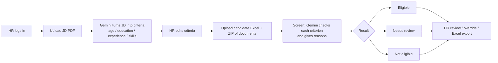
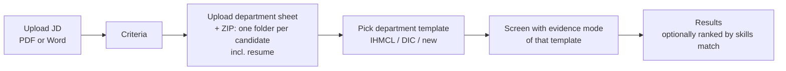
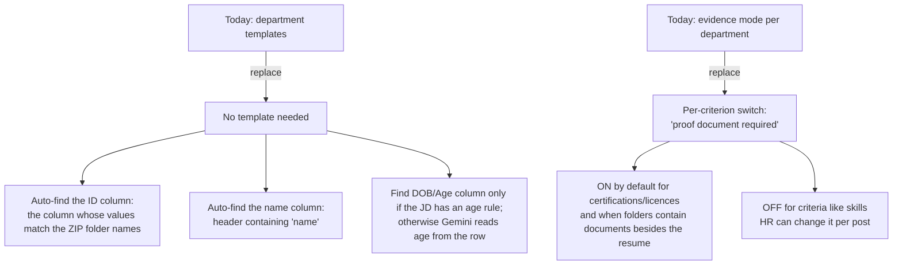

# DIC adaptation: what the app already did, what we changed, what's next

**Goal:** take the IHMCL screening tool and make it a generic tool any department can use. DIC (Data Analyst post) is the first test case.
The DIC Excel and JD in the DIC folder are **samples** of how a department collects data. They are not a fixed format.

---

## 1. What the application already did (IHMCL)

Key points of the original:
- JD had to be a **PDF** (gazette style, several posts, age-relaxation table).
- Candidate sheet had fixed column names (`Id.`, `Name`, `Gender`...) and per-document URL columns.
- Documents (marksheets, certificates, experience letters, CV) were the **proof**. The CV was only a "claim".
- Results always shown in Excel upload order.

---

## 2. What we changed so far (not committed yet)

| # | Change | Where (main files) |
|---|---|---|
| 1 | JD can be uploaded as **Word (.docx)** as well as PDF | `pdf_extraction.py`, `jd_upload.py` |
| 2 | Candidate sheet reader handles real `.xls`/`.xlsx`, skips a title row above the headers, fixes IDs like `1.0` -> `1`, converts Excel dates | `column_mapping.py` (new) |
| 3 | **Department templates**: says which Excel column is ID / name / category etc. IHMCL and DIC are pre-made. Admin can add one in Preferences | `department_template.py`, `department_templates.py`, `TemplateManager.tsx` (new) |
| 4 | Documents ZIP works **without per-document URL columns**: resume is found by file name ("resume"/"cv"), other files are supporting documents | `candidate_ingestion.py` |
| 5 | **DIC evidence mode**: Excel row + resume are the evidence; a missing certificate does not force "Needs review"; experience counts only jobs relevant to the JD and lists which were counted | `gemini_service.py`, `candidate_evaluation.py` |
| 6 | **Ranking**: "Rank by skills match" on Results and in the Excel export (eligible, then needs review, then not eligible; highest skills match first) | `results.py`, `ReportsPage.tsx` |
| 7 | Visible org name is configurable (`VITE_ORG_NAME`, default DIC). Database names left unchanged on purpose | `branding.ts`, Sidebar, Login |

New flow with the changes:

### Tested vs not tested
- Tested on the real DIC files: sheet loading (151 rows), folder-to-row matching with a fake ZIP, `.docx` JD reading, frontend typecheck.
- **Not tested:** database changes, Gemini screening in DIC mode, the new screens in a browser, the old IHMCL upload path after the changes.

### Known gap
If the batch Gemini call fails and falls back to one call per criterion, those calls do not get the DIC evidence rules.

---

## 3. Decisions made in discussion

- Resumes come **inside the ZIP** (no downloading from links, no optional resume).
- Gemini is **not** used to map columns.
- Branding is **parked** for now; the small branding edits stay but can be reverted.
- Evidence rules must **not** be hard-coded per department (some posts will need certificates).

---

## 4. What we plan to do next

Steps:
1. Remove the template feature (backend model/router, Settings screen, upload picker).
2. Add the automatic ID / name column detection.
3. Add the "proof document required" switch to each criterion (criteria editor + screening prompt).
4. Fix the known gap above (apply the same rules in the fallback path).
5. Run the real end-to-end test (database + Gemini) on the DIC JD, DIC Excel and a sample ZIP of resume folders, and spot-check about 10 candidates by hand (e.g. the 9-month candidate must be Not eligible).
6. Confirm with DIC the real ZIP folder and resume file naming.
7. Revisit branding later.

---

## 5. Roster-only flow (no documents ZIP, no dependency on the department)

Upload only the department's sheet; nothing has to be built on their side.

1. `POST .../candidates/upload-roster` reads the sheet (header row, name/email/phone/DOB/category/resume-link columns auto-detected). The portal assigns each row its own ID (lower-cased email, else `row-<n>`), because sheets like DIC's only have a 1..N "S. No".
2. Normal batch screening judges each candidate from the sheet row alone (`declared_primary` evidence mode; roster candidates are recognised by `resume_fetch_status`).
3. `POST .../fetch-resumes` downloads resumes **only for eligible / needs-review candidates**, in the background (`RESUME_FETCH_CONCURRENCY`, default 6), then re-screens each with the resume. A link that fails (login page, 404, not a PDF, no link) moves the candidate to **needs review** with the reason shown. `retry_failed=true` retries.
4. `POST .../resumes-zip` is the fallback: PDFs matched to candidates by email, phone or first+last name in the file name.

Files: `roster_ingestion.py`, `resume_fetcher.py`, `routers/resumes.py`, `ResumeFetchPanel.tsx`.

**Not done yet:** per-criterion "proof document required" switch (so a post that needs a certificate can demand one), removal of the department-template feature, and `.xls` hyperlink extraction tested on a real file (the sample DIC sheet contains no resume links).

---

## 6. Must-have vs soft criteria, near-miss exception, ranking

- **JD classification:** the JD parse now returns `mandatory` per criterion, from the JD's own wording ("mandatory / essential / minimum / required" vs "desirable / preferred"). It sets `is_essential` (shown as **Must-have**); HR can flip it. Skills are always soft. Falls back to the old wording heuristic when Gemini omits the flag.
- **Age pre-filter:** age is rule-based and runs before Gemini. An essential age failure -> Not eligible with zero Gemini calls (`PREFILTER_BY_AGE=0` turns it off).
- **Near-miss exception:** an essential experience criterion that fails by <= `experience_tolerance_years` (default 2) becomes **Needs review**. With skills match >= `exception_skills_threshold` (default 80) it is tagged `strong_exception` ("Strong candidate, with exception"). Roster candidates whose skills can't be judged yet are tagged `awaiting_resume`, so the resume fetch picks them up; after the fetch they become strong_exception or Not eligible. Further short, or weak skills -> Not eligible (the 9-month candidate stays rejected). A resume that can't be fetched -> `resume_unavailable`.
- **Suitability score (0-100):** weighted average of skills match, experience match and desirable items (weights default 50/30/20, renormalised over the sections the post has). Results "Rank by suitability": Eligible, then Needs review (strong exceptions first), then Not eligible; by score within each.
- Settings per post: `PATCH /jd/profiles/{id}/settings`, and the "Screening rules for this post" card on the criteria step.

**Caveats:** `documented_years` / `required_years` come from the batched Gemini call; the per-criterion fallback path doesn't return them, so the exception can't apply there (a genuine fail stays a fail). Profiles created before this change keep their old essential flags until the criteria are restored/edited.

---

## 7. Fixed skill marks, Government Relevant Experience, sheet-resume mismatch

- **Skill marks (Gemini only classifies):** the skill criterion now holds a list of individual skills (`criteria.skill_items`), returned by the JD parse and editable on the criteria step. Each skill has an HR **weight dropdown: 1 / 0.5 / 0** (0 = shown, not scored). During screening Gemini only says, per skill, whether the candidate's skill is the **same** (1 mark; naming variant, or a specific tool of the JD's broader skill, e.g. Pandas for Python), **related** (0.5; does the same job, e.g. Tableau for Power BI, C++ for Java) or **none** (0). Points = mark x weight; skills match % = points / total weight. Stored per skill in `criterion_evaluations.skill_marks` and shown as a table on the candidate page.
- **Government Relevant Experience tag:** a separate small Gemini call lists every job and flags it government/GovTech and role-relevant. The tag needs **both** (government admin then private data analyst = no tag). Only checked for eligible / needs-review candidates; never shown on not-eligible ones. Ranking: within Eligible and within Needs review, tagged candidates come first.
- **Sheet vs resume mismatch:** an otherwise eligible candidate whose resume contradicts the sheet goes to **Needs review**, tagged `data_mismatch`, with the items listed. The score is not lowered.

**Not done yet:** HR screening report and one-page hiring-committee brief. Profiles created before this change get their skill list split from the description (check it on the criteria step). The per-criterion fallback path returns no skill classification, so no skills score there.

### Printable reports
Candidate page -> **HR report** / **Committee brief** buttons open `/candidate/:profileId/:candidateId/print/hr|brief` (no app chrome; "Print / save as PDF" uses the browser dialog, A4).
- **HR screening report:** status, rank, skills score, suitability, tags; HR override; every criterion with result, reasoning and source; the per-skill marks table; government experience jobs; sheet vs resume check; CV certificates; documents; sign-off lines.
- **Hiring committee brief (one page):** work history, experience/education requirements met, skills grouped as has / related only / missing, certificates, points to probe (built from the related and missing skills, no AI) and a panel-notes box. Leaves out the sheet-vs-resume check and HR overrides.
